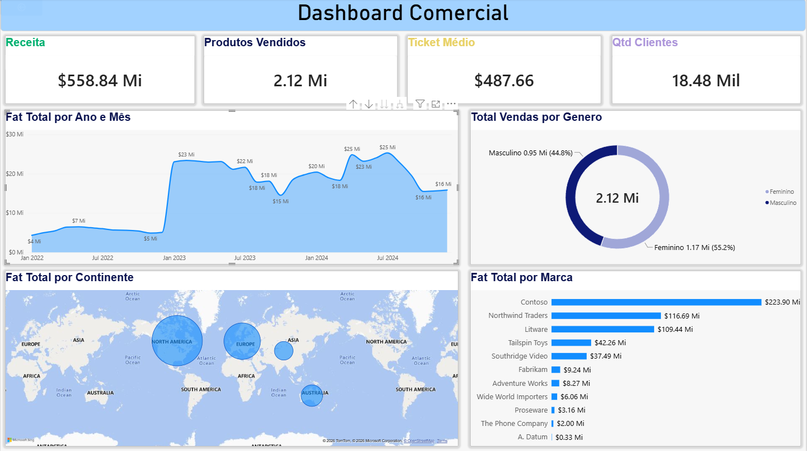

# Dashboard Comercial em Power BI

Projeto de análise comercial em Power BI, utilizando dados fictícios de varejo para explorar indicadores e apoiar a interpretação dos resultados.

## Dashboard

## Objetivo

Explorar indicadores comerciais em um relatório interativo: receita, produtos vendidos, ticket médio e quantidade de clientes, com análises por período, gênero, continente e marca.

## Conhecimentos praticados

- Importação e tratamento de dados no Power Query.
- Relacionamentos entre tabelas.
- Criação de medidas em DAX.
- Construção de gráficos, cartões e interações no Power BI.

## Observações analíticas

Na captura, a Contoso apresenta aproximadamente 223,90 milhões de faturamento, cerca de 40% do total de 558,84 milhões. Essa concentração permite investigar a participação das marcas na receita.

A mudança entre o final de 2022 e o início de 2023 merece investigação: é necessário conferir a cobertura dos dados antes de atribuí-la a crescimento do negócio.

Os valores da imagem estão arredondados. A moeda de negócio e a definição do ticket médio devem ser conferidas no modelo antes do uso dos indicadores em decisões.

## Como abrir

1. Baixe [TrainPowerBi.pbix](TrainPowerBi.pbix).
2. Abra o arquivo no Power BI Desktop.
3. Explore os filtros e as interações entre os visuais.

A atualização pode exigir ajuste dos caminhos das fontes no Power Query. As planilhas de origem não estão incluídas neste repositório.

## Próximas melhorias

- Padronizar os formatos numéricos e os títulos.
- Melhorar o contraste dos cartões e a leitura do mapa.
- Documentar as medidas DAX e validar as definições dos indicadores.
- Adicionar análises próprias e comparações entre períodos.
